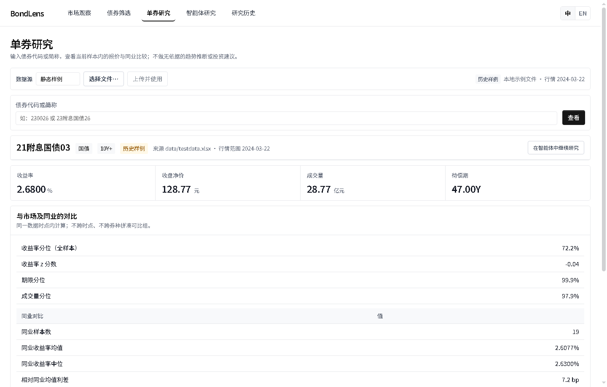
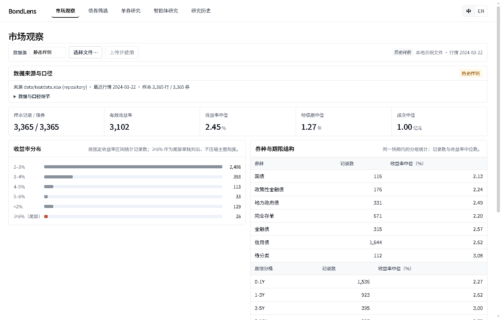
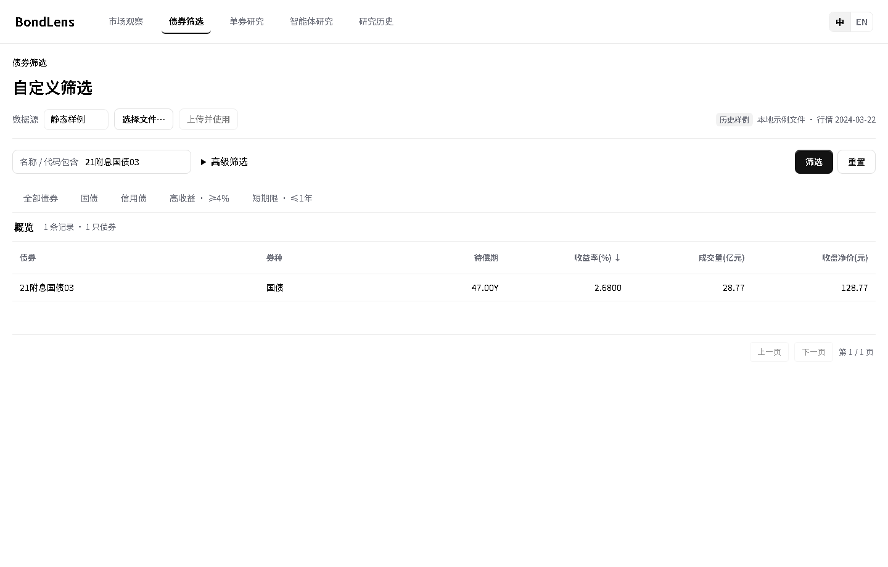
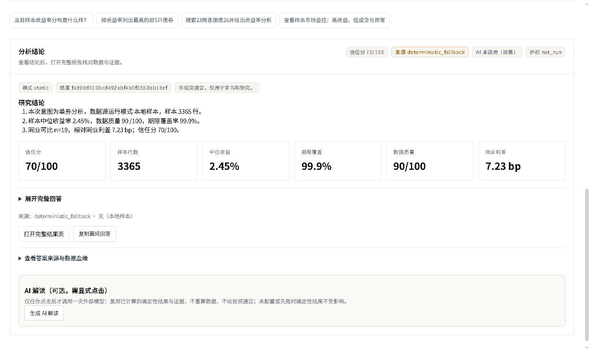
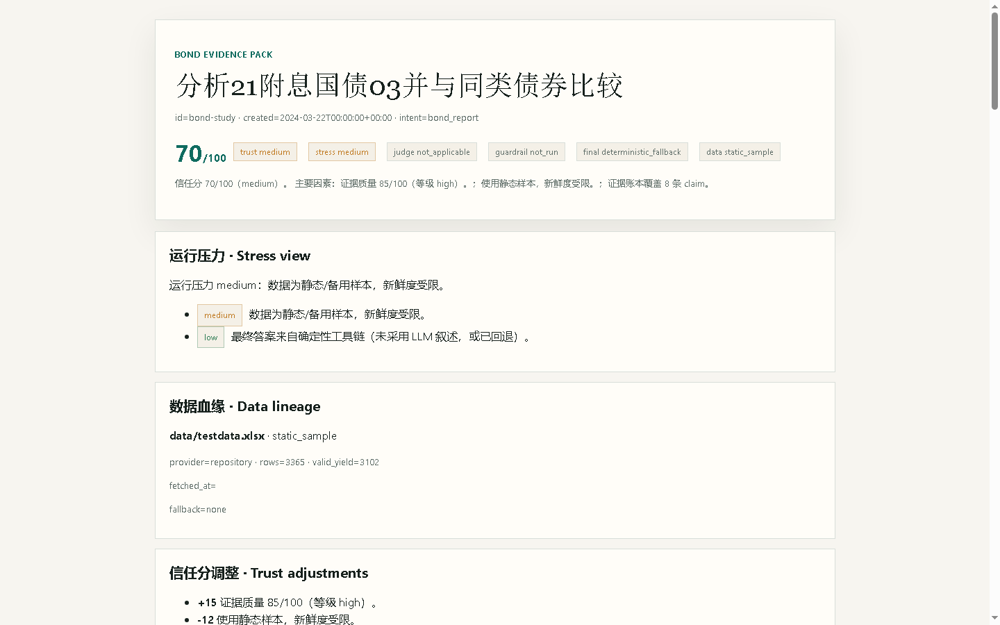
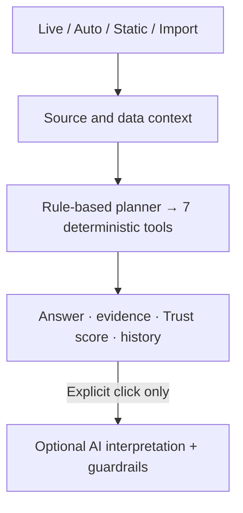

# BondLens

[English](README.md) · [简体中文](README.zh-CN.md) · [Technical guide](docs/TECHNICAL_GUIDE.md)

A local workbench for Chinese bond research: **market overview → bond screening → peer comparison → deterministic research → evidence and saved history**. Numerical results come from inspectable tools; AI interpretation is optional and requires an explicit click.

 

No model configuration or API key is needed for the built-in sample. BondLens is a research and learning demonstration, not investment advice or a trading system.

## One real, reproducible research case

**Target: 21附息国债03**, a Chinese government bond. The source is the repository's **March 22, 2024 static sample** (3,365 quote records, not live quotes). The figures and screenshots below all come from the same fixed bond and dataset:

| Target yield | Comparable peer records | Peer mean yield | Spread over peer mean |
| :---: | :---: | :---: | :---: |
| **2.68%** | **19** | **2.6077%** | **+7.23 bp** |

[](docs/portfolio_case/screenshots/03-bond.png)

**Inspect the evidence:** [Bilingual case study](docs/portfolio_case/CASE_STUDY.md) · [Open the rendered HTML research report (no install)](https://phoenix0531-sudo.github.io/BondLens/portfolio_case/bond-study.html) · [Full evidence JSON](docs/portfolio_case/bond-study.json) · [Workbench calculation JSON](docs/portfolio_case/case-data.json)

The 19 peer records have the **same bond type and maturity bucket**, excluding the target. This sample has no per-row quote date, so **same-day alignment cannot be verified**. A yield difference is not a default probability or investment recommendation. The case study documents its peer method and teaching-level duration assumptions.

## From market data to evidence: one consistent case

Every image was captured from the real local app with the same static dataset and bond, without a live feed or paid model call. Click to enlarge.

| ① Market: sample source and structure | ② Screen: select the exact bond |
| :---: | :---: |
| [](docs/portfolio_case/screenshots/01-market.png) | [](docs/portfolio_case/screenshots/02-screen.png) |
| ③ Research: deterministic result and limits | ④ Evidence Pack: Trust and data lineage |
| [](docs/portfolio_case/screenshots/04-agent.png) | [](docs/portfolio_case/screenshots/06-evidence-pack.png) |

The final step is [⑤ Research History](docs/portfolio_case/screenshots/05-history.png): persisted results are read-only, while re-running creates a new record. The screenshot uses only isolated demonstration history, not private records.

You can also watch the [60-second screenshot-based interface tour](https://phoenix0531-sudo.github.io/BondLens/portfolio_case/walkthrough.mp4) (silent, assembled from authentic screenshots; not a live-click recording).

**Reproduce the case:**

```bash
python scripts/generate_portfolio_case.py          # Generate the case and static HTML/JSON pack
python scripts/generate_portfolio_case.py --check  # Recompute and verify files without changing them
node scripts/capture_portfolio_case.mjs            # Optional: recapture six real UI screens in isolated Edge
python scripts/build_portfolio_walkthrough.py     # Optional: rebuild the video tour with FFmpeg
```

## Why it is built this way

- **Calculations before prose.** A rule-based intent planner selects from seven deterministic bond-analysis tools. Search, ranking, market summaries and peer comparisons can be inspected without a model; an optional model does not replace those calculations.
- **Context before comparison.** Data mode, source, date and missing fields are exposed instead of silently filled in. Same-day, same-type and same-maturity-bucket peers provide a more meaningful comparison; when dates are absent, same-day alignment cannot be verified.
- **Evidence before interpretation.** A research result can include a Trust score, evidence ledger and portable HTML/JSON Evidence Pack. Saved history supports read-only review. AI is never invoked automatically: a configured provider may be contacted only after the user explicitly requests an interpretation; sending imported data requires confirmation.



## Explore without installing

These are **other pre-generated historical HTML demos** (different runs from the unified bond case above), not a running interactive service:

- [Market overview](https://phoenix0531-sudo.github.io/BondLens/demo_runs/demo-market-overview.html)
- [Older single-bond report](https://phoenix0531-sudo.github.io/BondLens/demo_runs/demo-bond-report.html)
- [Yield-outlier report](https://phoenix0531-sudo.github.io/BondLens/demo_runs/demo-yield-outliers.html)

[GitHub Pages](https://phoenix0531-sudo.github.io/BondLens/) is a static project page, not an online instance of the workbench.

## Run locally

Python 3.12 is the deployment baseline; Python 3.11+ is supported. These commands explicitly use the offline static sample and require no API key.

**Windows PowerShell**

```powershell
py -3.12 -m venv .venv
.\.venv\Scripts\Activate.ps1
python -m pip install -r requirements.lock
$env:BOND_DATA_MODE = 'static'
python app.py
```

**Linux / macOS**

```bash
python3.12 -m venv .venv
source .venv/bin/activate
python -m pip install -r requirements.lock
export BOND_DATA_MODE=static
python app.py
```

Open **http://127.0.0.1:5000/**. The local server binds to loopback by default; set `PORT` to choose a different port. For Docker, environment options, API and test commands, see the [technical guide](docs/TECHNICAL_GUIDE.md). Compose maps port 8765 by default.

## Data and safety boundaries

- **Live** is strict: failure returns an error, never a static or snapshot fallback. **Auto** may fall back from live to a valid snapshot and then static, while reporting the actual source and time. **Static** does not contact live providers. **Import** is held in memory and must be uploaded again after expiry.
- The sample does not include issuer ratings, financial statements or credit events. Duration and DV01 use stated teaching-level assumptions, not a full valuation model; yield anomalies are signals for research, not trading advice.
- History saves a privacy-reduced derived result, not the original uploaded attachment. Some imported text cannot be restored; older summary-only records cannot restore a full result. Re-running creates a new record. Redaction is best-effort: do not enter secrets or sensitive identifiers.
- History uses server-side pages of 20. A cold keyword search across thousands of records can still be slow: an isolated 3,300-record test took approximately 19.5 seconds. The [guide](docs/TECHNICAL_GUIDE.md#history-and-evidence-packs) explains storage and its limits.
- There is no built-in authentication or per-user history isolation. Use locally on a trusted machine; this is not a public multi-user service. Real Live providers and paid models have not been validated for production use.

## Verification and background

On **2026-10-31**, an independent local run recorded **252 passed, 1 skipped**; GitHub Actions succeeded for commit `595b87e`. These are historical results; the badge shows current CI status.

BondLens began as a 2024 undergraduate thesis. The original version is preserved on the `undergraduate-thesis-2024` branch. See the [technical guide](docs/TECHNICAL_GUIDE.md) for the tool catalog, APIs, import mapping, deployment, evidence packs and recorded examples.

Licensed under [MIT](LICENSE). BondLens does not provide investment advice or claim complete market coverage.
