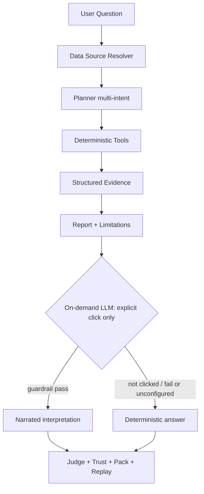

# BondLens: An Evidence-First Chinese Bond Research Workbench

[English](README.md) | [中文](README.zh-CN.md)

<div align="center">


**An evidence-first workbench for Chinese bond research**

Deterministic calculations first · traceable sources and evidence · optional AI interpretation only on explicit request.


**BondLens** brings together Market, Screen, Bond, Agent and History: explore data, run deterministic research and revisit saved evidence. Ordinary research needs no LLM configuration; AI interpretation is optional.

[Project page](https://phoenix0531-sudo.github.io/BondLens/) · [Social preview](docs/figs/voxel_social.png) · light badge: [logo](docs/figs/logo_white_background.png)

> Non-investment advice. For learning, research, portfolio demonstration, and interview discussion only.

</div>

## Runtime and deployment

Python 3.12 is the deployment baseline (Python 3.11+ supported). Flask/Jinja, pandas and Pydantic power the workbench; an OpenAI-compatible SDK is optional. No API key is needed for local sample analysis.

**Windows PowerShell**
```powershell
py -3 -m venv .venv
.\.venv\Scripts\Activate.ps1
python -m pip install -r requirements.lock
$env:BOND_DATA_MODE = 'static'
python app.py
```

**Linux / macOS**
```bash
python3 -m venv .venv
source .venv/bin/activate
python -m pip install -r requirements.lock
export BOND_DATA_MODE=static
python app.py
```

Open `http://127.0.0.1:5000/`. `python app.py` binds to loopback and port 5000 by default; set `PORT` to choose another port. These examples explicitly select Static; the application otherwise uses its configured mode. The [GitHub Pages project page](https://phoenix0531-sudo.github.io/BondLens/) is static documentation, not the interactive workbench.

For tests and development, install the pinned runtime plus development extras with `python -m pip install -r requirements.lock -r requirements-dev.txt`. The development file does not include runtime dependencies by itself. The V1.1 local Windows regression recorded **248 passed, 1 skipped**, and GitHub Actions succeeded for commit `c07fbed`; these are historical checks, not live-provider validation. See the badge for current CI status.

Configuration is read from process environment; `.env.example` lists the options. `python app.py` is for local use, not an Internet-facing production server. For deployment, use `docker compose up --build`. The Compose port mapping binds to `127.0.0.1` by default (`BOND_BIND_HOST`), so the workbench is reachable only from the local machine; choose a trusted-network binding or an authenticating reverse proxy deliberately if you need wider access. This loopback default is a safe default, not a complete security solution. The non-root container runs one Gunicorn process with four threads; do not increase worker processes while result URLs use in-memory caching. Interactive result-cache links expire after 30 minutes or a service restart; versioned research history and exported packs survive Compose restarts in the `bondlens-data` volume when persistence succeeds. Older summary-only entries cannot restore an original result. Back up that volume if history matters; `docker compose down -v` deletes it.

### Data modes and history

- **Live** requires real-time data and returns an error on failure; it never falls back to a snapshot or static sample. **Auto** tries live, then a valid snapshot, then static, and shows actual source and time. **Static** does not contact live providers. **Import** is held in memory; an expired session must be uploaded again.
- Startup and ordinary research do not call paid AI. Only an explicit interpretation request with a configured model may contact a provider; imported data requires confirmation before it is sent.
- Saved history and evidence packs contain sanitized derived results, not the uploaded attachment or entire table. Some imported free text cannot be restored. A saved result is read-only; re-running creates a new record. Legacy summary-only entries cannot restore the full result. Redaction is best-effort, so do not enter secrets.

**Known limitation:** `/replay` currently loads all entries at once. In local testing with several thousand history entries, the page exceeded a 25-second timeout; this has not been fixed. Use separate `BOND_REPLAY_DIR` and `BOND_EVIDENCE_PACK_DIR` locations for demonstrations, and back up archive directories when needed. Do not delete existing history to work around this limitation.

### Docker operations

- Open `http://localhost:8765/` (market workbench) or `/agent` (research page); health check: `/healthz`; API contracts: `/api/agent/schema`.
- Compose reads `.env` for variable substitution; direct Python execution does not automatically load it. Set `BOND_DATA_MODE=static` for offline sample analysis, or `auto` for live → snapshot → sample fallback.
- Start: `docker compose up --build -d`; inspect: `docker compose logs --tail=100 bondlens`; restart: `docker compose restart bondlens`; stop without deleting history: `docker compose down`.
- The service is `bondlens`, container `bondlens-demo`, image `bondlens:local`; port mapping is `${BOND_BIND_HOST:-127.0.0.1}:${BOND_HOST_PORT:-8765}:5000`. The default loopback binding keeps the workbench local-machine-only; to expose it on a LAN or behind a reverse proxy, set `BOND_BIND_HOST` explicitly (e.g. `0.0.0.0` or a LAN IP) and put an authenticating reverse proxy in front first. Inside the container Gunicorn still listens on `0.0.0.0:5000`.
- Native Linux deployment can use `gunicorn --workers 1 --threads 4 --timeout 180 -b 127.0.0.1:5000 app:app`. Gunicorn is not supported on Windows; use Docker there for this deployment setup.
- `BOND_REPLAY_ENABLED` controls history. `BOND_REPLAY_DIR` and `BOND_EVIDENCE_PACK_DIR` override storage roots; defaults are `.tmp/replays` and `.tmp/evidence_packs`. Keep Docker overrides under `/app/.tmp` to retain volume persistence. History stores a sanitized derived result (maximum 2 MiB), including bounded result rows, not the raw uploaded file or complete table. Imported free text and bond names are omitted from saved projections and cannot be recovered; other redaction is best-effort, so do not enter secrets or sensitive identifiers in questions or bond names. No automatic historical deletion is performed.
- Optional host Ollama from Docker: set `OPENAI_BASE_URL=http://host.docker.internal:11434/v1`, `OPENAI_MODEL` to an installed model, and `OPENAI_API_STYLE=chat`. No paid model is required. Demo scripts clear `OPENAI_*` unless `BOND_DEMO_WITH_LLM=1` is explicitly set.
- Update dependencies intentionally: `uv pip compile requirements.txt --python-version 3.12 --universal --output-file requirements.lock`, then validate before rebuilding.

Requests are limited to 1 MiB and questions to 4,000 characters. Stream errors do not automatically repeat potentially paid model calls. Stopping receipt in the browser does not guarantee cancellation at the provider. LLM requests default to a 20-second per-call timeout; provider fallback/repair may take longer.

This is a single-instance research tool, not a public multi-user financial service. There is no authentication or private per-user history: put it behind an authenticated reverse proxy before exposing it beyond trusted users. Live-data redistribution and provider commercial terms must be checked separately; the project MIT license does not grant market-data rights.

### Example Runs (no API key — open in browser)

| Run | What you see | Open |
| --- | --- | --- |
| Market overview | Sample yield / volume board + trust-facing pack | [demo-market-overview.html](docs/demo_runs/demo-market-overview.html) |
| Single-bond report | First-bond style report with evidence body | [demo-bond-report.html](docs/demo_runs/demo-bond-report.html) |
| Yield outliers | Cross-section outlier monitor pack | [demo-yield-outliers.html](docs/demo_runs/demo-yield-outliers.html) |
| LLM final-answer matrix | Recorded CPA path (zh/en × overview/bond) | [llm_matrix_cpa_gpt54.md](docs/demo_runs/llm_matrix_cpa_gpt54.md) |

Raw JSON siblings live under [docs/demo_runs/](docs/demo_runs/).

---

## Table of Contents

- [Scope](#scope)
- [Design Principle](#design-principle-deterministic-compute-llm-narration)
- [Architecture](#architecture)
- [Screenshots](#screenshots)
- [Quick Start](#quick-start)
- [Language (i18n)](#language-i18n)
- [Tool Catalog](#tool-catalog-deterministic-operators)
- [Trust Score & Evidence Pack](#trust-score--evidence-pack)
- [Example Questions](#example-questions)
- [API](#api)
- [Data Source Boundary](#data-source-boundary)
- [LLM matrix (recorded)](docs/demo_runs/llm_matrix_cpa_gpt54.md)
- [Background](#background)
- [License](#license)
- [Disclaimer](#disclaimer)

---

## Scope

| In scope | Out of scope |
| --- | --- |
| Chinese bond market questions in natural language | Multi-agent equity research desktop |
| Live / snapshot / static data with explicit lineage | Issuer ratings, financials, guarantees, credit events |
| Deterministic yield / volume / ranking / outlier tools | Trade recommendations or buy/sell signals |
| On-demand AI interpretation (explicit click) under numeric + language guardrails | Model inventing numbers outside tool evidence |
| Trust score, Evidence Pack, replay, red-team evals | Full OAS / call-tree valuation desk |
| Bilingual UI (zh default) + portable demo packs | Complete market coverage claims |

**Honest scale:** ~10k lines of project Python (`bond_agent/` + app/tests/evals) — a focused vertical, not a 100k+ multi-agent platform.

---

## Design Principle: Deterministic Compute, LLM Narration

BondLens strictly separates **deterministic financial computation** (tools never invent numbers) from **LLM-based narration** (text only, numbers must match evidence). See the [Tool Catalog](#tool-catalog-deterministic-operators) for what tools produce deterministically, and the [Trust Score](#trust-score--evidence-pack) layer for the guardrail + judge that gates narrative text.

**Tools compute, models narrate, trust decides.** The model is never invoked automatically: even with `OPENAI_API_KEY` set, the pipeline stays zero-model until you explicitly click "Generate AI interpretation" on the result page — exactly one request that reuses the already-computed deterministic result and evidence, never recomputing data. Successful interpretations are cached (result pages ~30 min with the result; bond pages by target), so a repeated request returns the stored text without another model call; failures are never cached and an explicit retry may call again. When unconfigured or failed, the deterministic result stands alone, unaffected.

### Codebase Snapshot

| Layer | What it includes |
| --- | --- |
| **Agent core** | Single path: Planner → Tools → Evidence → Report |
| **Deterministic tools** | 7 public operators: `search_bonds`, `describe_market`, `rank_bonds`, `detect_yield_outliers`, `compare_bond_to_market`, `build_market_monitor`, `generate_bond_report` |
| **Trust layer** | Numeric + language guardrail · answer judge · Trust score · Evidence Pack · replay store · risk profile |
| **Evals** | V1.1 local Windows run: 248 passed / 1 skipped; Actions passed at `c07fbed`. See the badge for current CI status. |
| **Data** | AkShare live → cached snapshot → static Excel, with explicit lineage and maturity coverage board |
| **Product surface** | Flask + Jinja · zh-default / en switch (query+cookie) · SSE soft-render · CI + GitHub Pages |

---

### Product surfaces (answer-first)

- **Research workbench**: five navigation entries — Market (`/market`), Screener (`/screen`), Bond Study (`/bond`), AI Research (`/agent`), and Research History (`/replay`, searchable and filterable table with pagination).
- **Answer Snapshot** + SSE soft final render: tool-step progress, token preview, final summary card without forced full-page reload; share/full board still via `result_url`
- **Bilingual UI (zh default)** + maturity/residual boards: high yield / low volume / yield outliers / missing maturity; same-type + same-bucket peer comparison
- **Trust score + stress view + audit folds**: guardrail / judge / risk / ledger behind `<details>`; research-history page for past runs

The workbench and the agent console share the same deterministic tools and the same import panel: uploaded snapshots can be screened and compared without an LLM, and every workbench view states its data source, sample date, and caliber honestly.

See the [Screenshots](#screenshots) below for each of these in action.

---

## Architecture

<div align="center">

</div>



See the [Tool Catalog](#tool-catalog-deterministic-operators) for the 7 deterministic operators used by `Planner → Tools`.

---

## Screenshots

Captured from the real local workbench with the static sample dataset (Edge 960×1040 / 1440×1000, no API key → zero model calls). Sample boards show the sample caliber with its explicit source date; nothing is presented as live quotes.
Narrative: **market board · screener · single-bond research · research history · optional natural-language analysis · auditable**.

Current product shots live in `docs/screenshots/current/`; the root screenshots folder now only keeps the GitHub social preview asset.

<table>
  <tr>
    <td width="50%">
      
      <br><strong>Market workbench — /market</strong>
      <br>Yield distribution, volume and source summary; calibers fold into expandable details.
    </td>
    <td width="50%">
      
      <br><strong>Screener — /screen</strong>
      <br>Multi-condition filtering over the built-in sample or uploaded CSV/Excel.
    </td>
  </tr>
  <tr>
    <td width="50%">
      
      <br><strong>Single-bond research — /bond</strong>
      <br>Identity, key metrics, peer comparison; AI panel stays idle until explicitly clicked.
    </td>
    <td width="50%">
      
      <br><strong>Optional NL analysis — /agent</strong>
      <br>Previous UI screenshot; the current view leads with conclusions and metrics, with the full answer folded.
    </td>
  </tr>
  <tr>
    <td width="50%">
      
      <br><strong>Can audit — research history / evidence path</strong>
      <br>Previous UI screenshot; the current history page is a searchable, filterable, paginated table of run summaries.
    </td>
    <td width="50%">
      <br><em>Older gallery shots (01–07) are kept in the folder for reference but no longer shown here.</em>
    </td>
  </tr>
</table>

---

## Quick Start

### 0 minutes (no install)

Open a pre-generated Example Run in the browser — no server, no API key:

```text
docs/demo_runs/demo-market-overview.html
```

Or jump from the [Example Runs table](#example-runs-no-api-key--open-in-browser) above.

### 5 minutes (offline demo)

```bash
pip install -r requirements.lock
./scripts/run_demo.sh
# open http://127.0.0.1:8765/agent
# try: 当前样本收益率分布是什么样？
```

Windows users can run the same deterministic demo with:

```bat
scripts\run_demo.bat
```

Other packs:

- [demo-market-overview.html](docs/demo_runs/demo-market-overview.html)
- [demo-bond-report.html](docs/demo_runs/demo-bond-report.html)
- [demo-yield-outliers.html](docs/demo_runs/demo-yield-outliers.html)

### 30 minutes (live path + fallback)

```bash
export FLASK_RUN_HOST=127.0.0.1
export PORT=8765
export BOND_DATA_MODE=auto   # live first, then snapshot, then static
python app.py
# force live: BOND_DATA_MODE=live
# in auto mode, inspect data_source.runtime_mode and fallback reason; live mode returns an error instead
```

On-demand AI interpretation (optional; even when configured it takes an explicit "Generate AI interpretation" click on the result page to fire a single request):

```bash
export OPENAI_API_KEY=... OPENAI_BASE_URL=http://127.0.0.1:18317/v1   # example: local CPA/OpenAI-compatible gateway
export OPENAI_MODEL=haochi/gpt-5.4
export OPENAI_API_STYLE=chat
export OPENAI_MODEL_FALLBACKS=haochi/gpt-5.4-mini,gongyi/deepseek-v4-flash-search   # optional
# Keys stay in process env only. Do not commit secrets.
```

### Docker demo

BondLens is Docker-packaged, but the portfolio demo does not require Docker.
The Compose service is intentionally named `bondlens`, with container name `bondlens-demo`, image `bondlens:local`, and host port `8765` mapped to container port `5000`.

```bash
docker compose up --build
# open http://localhost:8765/agent
# health: http://localhost:8765/healthz
```

---

## Language (i18n)

- Default UI language: **Chinese**
- Explicit switch in one place: the page header (`中 / EN`)
- Persistence: `?lang=zh|en` query wins, then `bondlens_lang` cookie, else `zh` (localStorage mirrors client-side)
- Covers templates, intent/tool labels, deterministic report skeleton, advisory refusal, and flash/error copy
- LLM system prompts follow the active language; logs stay developer-facing and are not fully bilingual

## Tool Catalog (deterministic operators)

| Tool | Inputs | Deterministic outputs |
| --- | --- | --- |
| `search_bonds` | name / type / maturity / yield filters | match_count, records |
| `describe_market` | active frame | yield/volume summaries, segments, data quality |
| `rank_bonds` | by, top_n, order | ranked records |
| `detect_yield_outliers` | method, threshold | outlier_count, scores |
| `compare_bond_to_market` | bond / record | percentiles, peer comparison |
| `build_market_monitor` | top_n | high-yield / low-volume / outliers / missing maturity |
| `generate_bond_report` | tool outputs + plan | analysis, risk notes, limitations |

Numbers in the final answer must come from these tools (or be rejected by the guardrail).

---

## Trust Score & Evidence Pack

Each answer includes `trust_score` (0–100) built from evidence quality, data freshness/degradation,
ledger coverage, guardrail outcome, judge outcome, and a forced non-advisory penalty.

Every run can export a portable **Bond Evidence Pack** (JSON + static HTML):

- question / intent / tools
- data lineage + maturity coverage
- trust score + adjustments
- guardrail + judge + risk profile
- evidence ledger + final answer
- mandatory limitations

```bash
python scripts/generate_demo_packs.py
```

Runtime packs: `.tmp/evidence_packs/`  
Committed demos: [docs/demo_runs/](docs/demo_runs/)

### Maturity unmatched export

Live/snapshot feeds have **no native maturity field**. BondLens enriches matched names from the local security master and exposes:

```text
GET/POST /api/maturity/unmatched?format=csv&data_mode=static
GET/POST /api/maturity/unmatched?format=json&data_mode=static
```

The UI maturity board links to the same export for unmatched bond names.

### Local CSV/XLSX import

Upload a local snapshot (CSV/XLSX/XLS) and analyze it instead of the built-in feeds. The file is parsed in memory and deleted immediately; nothing is stored on disk or committed anywhere.

```http
POST /api/import
Content-Type: multipart/form-data

file=@snapshot.csv
```

The response returns an `import_id` plus an honest report: mapped columns, missing fields (dependent analyses are disabled, not guessed), same-name rows (kept, never deduplicated — `row_count` vs `bond_count`), and the sample date (kept when readable, explicitly marked "unknown" otherwise). Pass `import_id` with any query:

```json
{
  "question": "概览当前样本，并对比23附息国债26与同类债券",
  "import_id": "<id from /api/import>"
}
```

The agent page has the same upload control (上传本地数据); imported datasets live in memory only (limit 8, 1-hour TTL).

**Field-mapping confirmation/correction**: auto-mapping only accepts same-caliber column names; different-caliber columns such as 全价 (dirty price) or 成交金额 (turnover amount) are never auto-mapped and **explicit overrides for them are rejected** (dirty price ≠ clean price: accrued interest; turnover amount ≠ traded volume: unit/口径 mismatch). Unknown columns can still be mapped explicitly. Once you confirm the caliber, re-upload with `column_overrides` (JSON: target field -> source column):

```http
POST /api/import
Content-Type: multipart/form-data

file=@snapshot.csv
column_overrides={"待偿期": "剩余期限"}   # example: explicit unknown-column mapping
```

Multi-date files are flagged honestly (`mixed_timepoints`, date range) instead of being treated as one cross-section; the workbench pages show the same warning.

`.xls` support is backed by the declared xlrd reader (pinned in `requirements.lock`) with a dependency-existence test.

---

## Example Questions

```text
当前样本收益率分布是什么样？
搜索23附息国债26并给出收益率分析
打开今日市场监控面板：高收益、低成交与异常
按收益率列出最高的前5只债券
有没有收益率异常的债券？
筛选国债收益率大于 2.5 的债券
今天该不该买债？   # advisory policy block; no LLM
```

---

## API

```http
POST /api/agent/query
Content-Type: application/json

{
  "question": "搜索23附息国债26并给出收益率分析",
  "data_mode": "auto"
}
```

Streaming (SSE):

```http
POST /api/agent/stream
Content-Type: application/json

{
  "question": "当前债券市场样本概览如何？",
  "data_mode": "static"
}
```

Events include `status` (tool steps), `token` (partial text), and `final` (soft-render view + `result_url`).

Operational endpoints:

```text
GET  /healthz
GET  /api/agent/schema
GET  /replay
GET  /packs/<pack_id>.html
GET  /packs/<pack_id>.json
GET  /api/maturity/unmatched
```

Read-only workbench endpoints (shared by `/market`, `/screen`, `/bond`; all accept `data_mode` / `import_id` / `lang`):

```text
GET  /api/market/overview    # source identity, yield distribution, segments, data quality
GET  /api/bonds/search       # name/type/maturity/yield/volume filters, server-side sort + pagination
GET  /api/bond/detail?key=   # one bond: quotes, percentiles, peer comparison, rate sensitivity (teaching caliber)
GET  /api/data/source        # active source identity + available columns
```

Missing columns disable only the dependent views with explicit `*_column_missing` markers — nothing is guessed or fabricated.

Deployment notes: see [Runtime and deployment](#runtime-and-deployment).

---

## Data Source Boundary

```text
Primary:        ChinaMoney / AkShare-style spot deal fetch (direct preferred)
Snapshot:       .tmp/bond_spot_deal_snapshot.csv
Final fallback: data/testdata.xlsx
```

- Live fields used include bond name, clean price, yield, BP change, weighted yield, volume, and native residual maturity when present (`termToMaturity`)
- Residual maturity may still be incomplete → coverage board + trust penalty on weak coverage
- Cashflow duration / DV01 are **teaching-level** level-coupon estimates, not OAS / full call-tree valuation
- Perpetual-style residuals expose dual scenarios (first finite leg + theoretical perpetual), not a multi-century fake tenor
- No issuer ratings, financial statements, guarantees, or credit events
- Yield is a **risk signal**, not a trade instruction

Modes:

```text
auto   -> live first, cached snapshot second, local fallback third; shows fallback reason
live   -> strictly real-time; failure returns an error, never a snapshot or static fallback
static -> local Excel only
```

---

## Recorded LLM working path

A recorded CPA/OpenAI-compatible-gateway LLM path (zh/en x overview/bond-report) and its honest residuals live in [docs/demo_runs/llm_matrix_cpa_gpt54.md](docs/demo_runs/llm_matrix_cpa_gpt54.md). This is evidence of a working path, **not** a zero-bug claim; provider channel churn can still force deterministic fallback when models vanish, and the product still works without an API key.

---

## Background

This project started as a 2024 undergraduate thesis: a Flask-based bond data analysis system.
The original thesis version is preserved and should not be rewritten:

- Original thesis branch: `undergraduate-thesis-2024`
- Current branch: `main`

## License

MIT

## Disclaimer

BondLens is an engineering and research demonstration. It does not provide investment advice,
does not claim complete market coverage, and does not replace professional fixed-income research tools.
