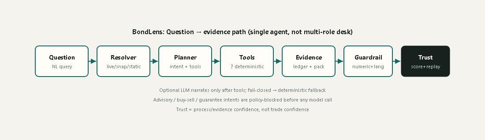
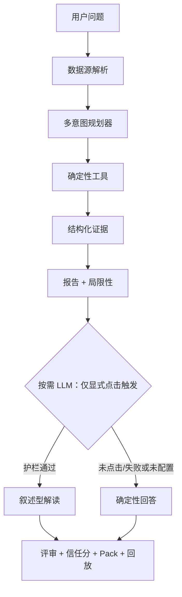
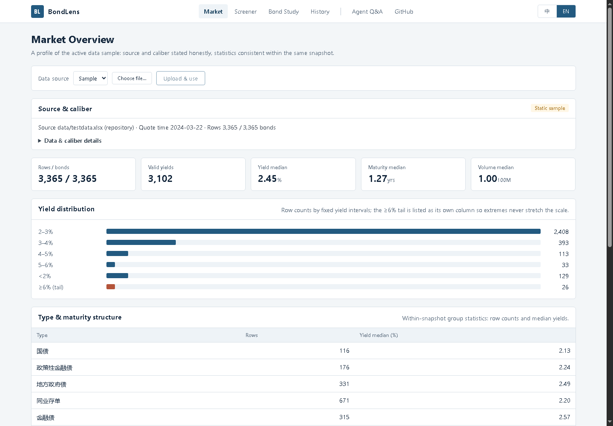
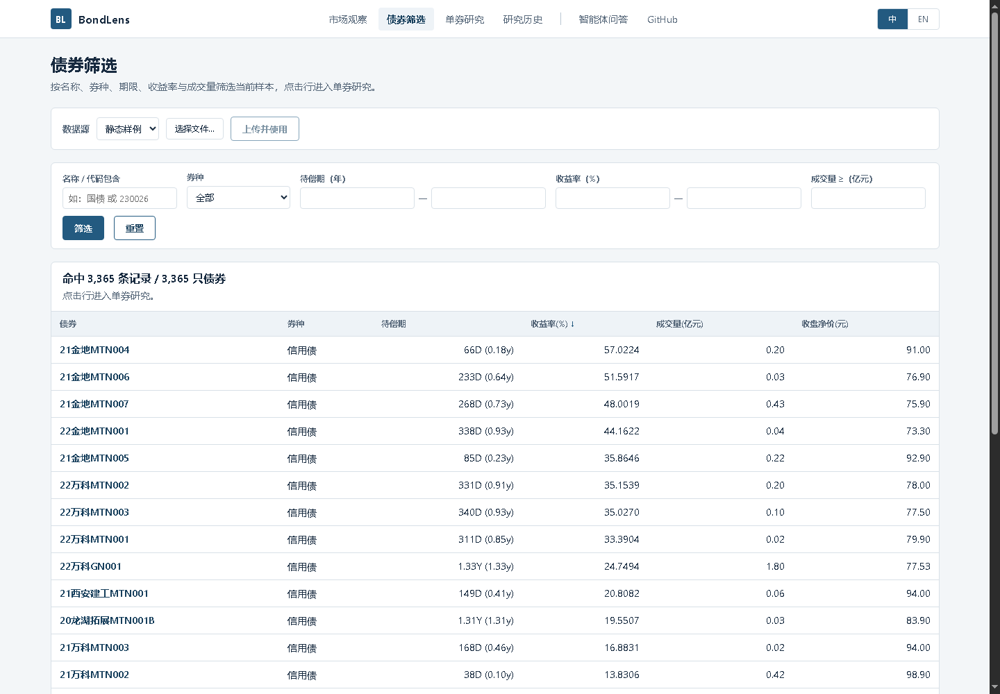
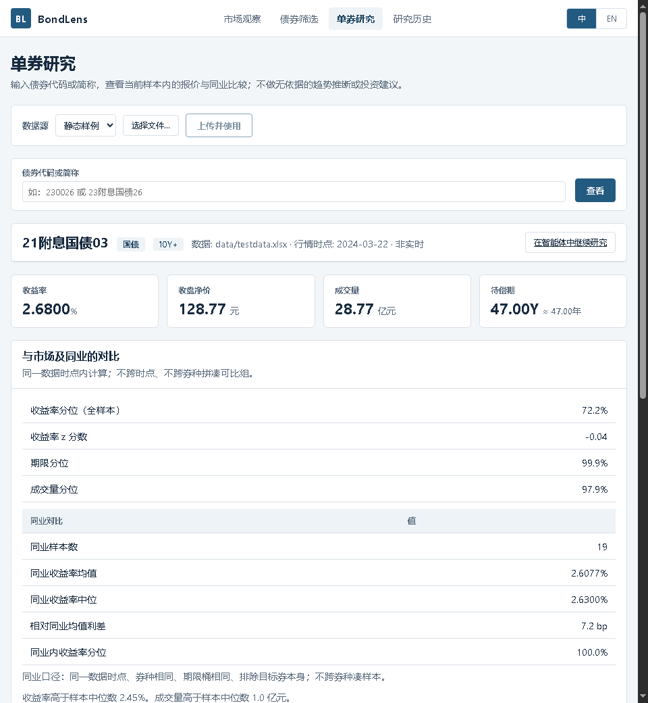
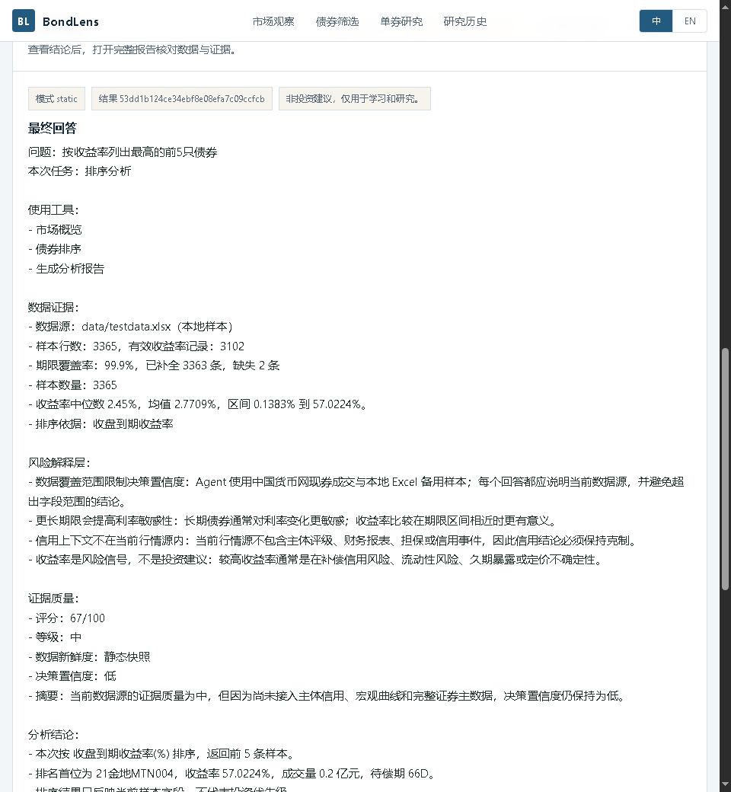
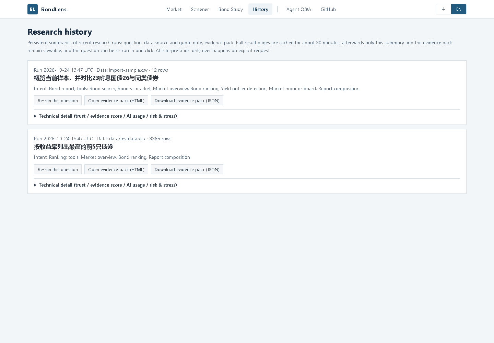

# BondLens：证据优先的中文债券研究工作台

[English](README.md) | [中文](README.zh-CN.md)

<div align="center">


**证据优先的中文债券研究工作台**

确定性计算为主 · 来源与证据可追溯 · AI 解读仅在明确请求时按需使用。


**BondLens** 提供市场观察、债券筛选、单券研究、智能体研究和研究历史五个页面：查看数据、运行确定性研究并回溯保存的证据。普通研究无需配置 LLM，AI 解读为可选功能。

[项目主页](https://phoenix0531-sudo.github.io/BondLens/) · [社交预览图](docs/figs/voxel_social.png) · 浅底徽章：[logo](docs/figs/logo_white_background.png)

> 本项目不提供投资建议，仅用于学习、研究、作品集展示和面试讨论。

</div>

## 运行与交付边界

部署基线为 Python 3.12（支持 Python 3.11+）；工作台使用 Flask/Jinja、pandas、Pydantic，可选 OpenAI 兼容 SDK。本地样本分析无需 API Key。

**Windows PowerShell**
```powershell
py -3 -m venv .venv
.\.venv\Scripts\Activate.ps1
python -m pip install -r requirements.lock
$env:BOND_DATA_MODE = 'static'
python app.py
```

**Linux / macOS**
```bash
python3 -m venv .venv
source .venv/bin/activate
python -m pip install -r requirements.lock
export BOND_DATA_MODE=static
python app.py
```

打开 `http://127.0.0.1:5000/`。`python app.py` 默认绑定本机回环地址和 5000 端口，可用 `PORT` 指定其他端口。上述命令显式选择 Static；未设置时应用使用其配置的模式。[GitHub Pages 项目页](https://phoenix0531-sudo.github.io/BondLens/)是静态介绍页，不是交互工作台。

运行测试或开发时，使用 `python -m pip install -r requirements.lock -r requirements-dev.txt` 同时安装锁定的运行依赖与开发附加依赖；单独安装 `requirements-dev.txt` 不包含运行依赖。V1.1 的 Windows 本地回归记录为 **248 passed、1 skipped**，提交 `c07fbed` 的 GitHub Actions 也已成功；这是历史验证，不代表实时供应商已验证，当前 CI 状态请看 badge。

配置从进程环境变量读取，选项见 `.env.example`。`python app.py` 仅用于本地开发；部署使用 `docker compose up --build`。Compose 端口映射默认绑定 `127.0.0.1`（`BOND_BIND_HOST`），即仅本机可访问；确需局域网或反代开放时，请显式设置绑定地址并自行部署带认证的反向代理。回环默认是安全默认值，不是完整的安全防护。容器以非 root 用户运行，采用单 Gunicorn 进程、四线程；结果缓存仍在进程内，不应直接增加 worker 数。临时结果链接在 30 分钟后或服务重启后失效；成功持久化的版本化研究历史与证据包保存在 Compose 的 `bondlens-data` 卷，重启保留，旧摘要不能恢复完整原结果，需要长期历史时备份该卷，勿执行会删除卷的 `docker compose down -v`。

### 数据模式与研究历史

- **Live** 严格使用实时数据，失败即报错，绝不回退至快照或静态样本。**Auto** 依次尝试实时、有效快照、静态样本，并显示实际来源和时间。**Static** 不访问实时供应商。**Import** 保存在内存中，会话过期后需重新上传。
- 默认启动和普通研究不会调用付费 AI；仅明确请求解读且已配置模型时才可能外联。导入数据外发前需要确认。
- 历史及证据包保存脱敏派生结果，不保存原始上传附件或整表；部分导入自由文本无法恢复。原结果只读，重新运行生成新记录；旧摘要记录无法恢复完整版。脱敏仅为尽力处理，请勿输入密钥。

**已知限制：** `/replay` 当前一次加载所有条目；曾在包含数千条历史记录的本地测试中观察到响应超过 25 秒，此问题尚未修复。演示可使用独立的 `BOND_REPLAY_DIR` 和 `BOND_EVIDENCE_PACK_DIR`，归档时按需备份目录；不要通过删除已有历史来绕过此限制。

### Docker 部署与维护

- 页面：`http://localhost:8765/`（市场工作台）或 `/agent`（智能体控制台）；健康检查：`/healthz`；API 契约：`/api/agent/schema`。
- Compose 会读取 `.env` 做变量替换；直接运行 Python 不会自动加载它。离线分析设置 `BOND_DATA_MODE=static`；`auto` 按实时 → 快照 → 样本降级。
- 启动：`docker compose up --build -d`；日志：`docker compose logs --tail=100 bondlens`；重启：`docker compose restart bondlens`；停止并保留历史：`docker compose down`。
- 服务名 `bondlens`、容器名 `bondlens-demo`、镜像 `bondlens:local`；端口映射 `${BOND_BIND_HOST:-127.0.0.1}:${BOND_HOST_PORT:-8765}:5000`。默认回环绑定即仅本机可访问；如需局域网或反向代理开放，请显式设置 `BOND_BIND_HOST`（如 `0.0.0.0` 或内网地址），并先自行部署带认证的反向代理。容器内 Gunicorn 仍监听 `0.0.0.0:5000`。
- 原生 Linux 可运行 `gunicorn --workers 1 --threads 4 --timeout 180 -b 127.0.0.1:5000 app:app`。Gunicorn 不支持 Windows；此部署方案在 Windows 使用 Docker。
- `BOND_REPLAY_ENABLED` 控制历史；`BOND_REPLAY_DIR` 与 `BOND_EVIDENCE_PACK_DIR` 可覆盖保存目录，默认分别为 `.tmp/replays` 与 `.tmp/evidence_packs`，Docker 中应保持在 `/app/.tmp` 下以使用持久卷。历史保存脱敏后的派生结果及有限结果行（上限 2 MiB），不保存原上传文件或整表；导入来源的自由文本及债券名称在保存投影时省略，无法恢复；其他脱敏仅为尽力处理，请勿在问题或债券名称中输入密钥或敏感标识。不会自动删除旧历史。
- Docker 连接宿主机 Ollama：设置 `OPENAI_BASE_URL=http://host.docker.internal:11434/v1`、`OPENAI_MODEL` 为已安装模型、`OPENAI_API_STYLE=chat`；不需要付费模型。演示脚本默认清空 `OPENAI_*`，仅显式设置 `BOND_DEMO_WITH_LLM=1` 时透传。
- 有意升级依赖时运行 `uv pip compile requirements.txt --python-version 3.12 --universal --output-file requirements.lock`，验证后再重建。

请求上限 1 MiB，问题上限 4000 字；流式失败不会自动重复付费分析。浏览器停止接收不保证取消提供商端计算。LLM 单次调用默认超时 20 秒，模型切换与修复可能使整体耗时更长。

产品定位仍是单实例研究工具，不是公网多用户金融服务。当前没有账号或按用户隔离的历史，超出可信用户范围前应接入带认证的反向代理。行情再分发和模型提供商商用条款需单独核查，MIT 许可证不授予行情数据使用权。

### Example Runs（无需 API Key — 浏览器直接打开）

| 运行 | 你会看到 | 打开 |
| --- | --- | --- |
| 市场概览 | 样本收益/成交看板 + 审查向 pack | [demo-market-overview.html](docs/demo_runs/demo-market-overview.html) |
| 单券报告 | 首券风格报告与证据正文 | [demo-bond-report.html](docs/demo_runs/demo-bond-report.html) |
| 收益异常 | 截面异常监控 pack | [demo-yield-outliers.html](docs/demo_runs/demo-yield-outliers.html) |
| LLM 终答矩阵 | 已记录的 CPA 路径（中英 × 概览/单券） | [llm_matrix_cpa_gpt54.md](docs/demo_runs/llm_matrix_cpa_gpt54.md) |

同目录还有对应 JSON：[docs/demo_runs/](docs/demo_runs/)。

---

## 目录

- [范围](#范围)
- [设计原则](#设计原则确定性计算大模型叙述)
- [架构](#架构)
- [项目截图](#项目截图)
- [快速上手](#快速上手)
- [语言（i18n）](#语言i18n)
- [工具目录](#工具目录确定性算子)
- [信任分与 Evidence Pack](#信任分与-evidence-pack)
- [示例问题](#示例问题)
- [API](#api)
- [数据源边界](#数据源边界)
- [LLM 实测路径（recorded）](docs/demo_runs/llm_matrix_cpa_gpt54.md)
- [背景](#背景)
- [许可证](#许可证)
- [免责声明](#免责声明)

---

## 范围

| 在范围内 | 不在范围内 |
| --- | --- |
| 中文债市自然语言问答 | 多 Agent 股权研究桌面端 |
| 实时 / 快照 / 本地数据，血缘可追溯 | 主体评级、财报、担保、信用事件 |
| 确定性收益 / 成交 / 排序 / 异常工具 | 交易推荐或买卖信号 |
| 按需 AI 解读（显式触发，数值 + 语言护栏） | 模型在证据外编造数字 |
| 信任分、Evidence Pack、回放、红队评测 | 完整 OAS / 含权树定价 desk |
| 双语界面（默认中文）+ 便携 demo pack | 完整市场覆盖声明 |

**诚实体量：** 项目 Python 约 1 万行（`bond_agent/` + app/tests/evals）——垂直产品，不是 10 万+ 多 Agent 平台。

---

## 设计原则：确定性计算，大模型叙述

BondLens 严格区分 **确定性金融计算**（工具不编造数字）与 **LLM 叙述**（仅文本，数字必须对齐证据）。详见 [工具目录](#工具目录确定性算子) 的确定性产出与下文 [信任分与 Evidence Pack](#信任分与-evidence-pack) 中控制叙述文本的护栏 + 评审。

**工具算数，模型讲故事，信任层做裁决。** 模型从不自动参与分析：分析链路默认零模型调用，即使已配置 `OPENAI_API_KEY` 也只在结果页显式点击「生成 AI 解读」后才发起单次请求，复用已计算的确定性结果与证据，不重算数据；成功后解读被缓存（结果页随结果缓存约 30 分钟；单券页按目标缓存），重复请求直接返回已缓存解读、不再调用模型；失败不缓存，可显式重试。未配置或失败时确定性结果独立可用、不受影响。

### Codebase Snapshot

| 层级 | 包含内容 |
| --- | --- |
| **Agent 核心** | 单路径：Planner → Tools → Evidence → Report |
| **确定性工具** | 7 个公开算子：`search_bonds`、`describe_market`、`rank_bonds`、`detect_yield_outliers`、`compare_bond_to_market`、`build_market_monitor`、`generate_bond_report` |
| **Trust 层** | 数值+语言护栏 · 答案评审 · Trust 分 · Evidence Pack · 回放 · 风险画像 |
| **评测** | V1.1 Windows 本地运行：248 通过、1 跳过；`c07fbed` 的 Actions 已通过。当前 CI 状态见 badge。 |
| **数据** | AkShare 实时 → 缓存快照 → 静态 Excel，显式血缘与期限覆盖看板 |
| **产品面** | Flask + Jinja · 默认中文 / 英文切换（query+cookie）· SSE 软渲染 · CI + GitHub Pages |

---

### 产品面（答案优先）

- **研究工作台**：五个导航入口 —— 市场观察（`/market`）、债券筛选（`/screen`）、单券研究（`/bond`）、智能体研究（`/agent`）、研究历史（`/replay`，表格支持搜索、筛选与分页）。
- **Answer Snapshot** + SSE 软终渲染：工具步骤进度、token 预览、最终摘要卡，无需强制整页刷新；完整看板仍走 `result_url`
- **双语界面（默认中文）** + 期限/残期看板：高收益 / 低成交 / 收益异常 / 缺期限；同券种 + 同分桶同业利差
- **信任分 + 压力视图 + 审计折叠**：护栏 / 评审 / 风险 / 账本收在 details 后；研究历史页可查过去运行

工作台与智能体控制台共享同一套确定性工具与上传面板：不经过 LLM 也能筛选、对比上传样本；每个工作台页面都如实标注数据源、样本日期与口径。

详见下文 [项目截图](#项目截图) 中每一项的实际表现。

---

## 架构

<div align="center">

</div>



详见 [工具目录](#工具目录确定性算子) 中规划器→工具使用的 7 个确定性算子。

---

## 项目截图

在本地真实工作台实拍（静态样例数据，Edge 960×1040 / 1440×1000，无 API Key → 零模型调用）。样例看板均标明样例口径与行情日期，不以静态样例冒充实时行情。
叙事：**市场看板 · 条件筛选 · 单券研究 · 研究历史 · 可选自然语言分析 · 可审计**。

当前产品图集中在 `docs/screenshots/current/`；根截图目录只保留 GitHub social preview 资产。

<table>
  <tr>
    <td width="50%">
      
      <br><strong>市场总览 — /market</strong>
      <br>收益率分布、成交量与来源摘要；口径细节折叠可展开。
    </td>
    <td width="50%">
      
      <br><strong>条件筛选 — /screen</strong>
      <br>内置样例或上传 CSV/Excel 的多条件过滤。
    </td>
  </tr>
  <tr>
    <td width="50%">
      
      <br><strong>单券研究 — /bond</strong>
      <br>关键指标、同业对比；AI 面板默认关闭，需显式点击。
    </td>
    <td width="50%">
      
      <br><strong>可选自然语言分析 — /agent</strong>
      <br>此前版本截图；当前界面优先展示结论与指标，完整回答默认折叠。
    </td>
  </tr>
  <tr>
    <td width="50%">
      
      <br><strong>可审 — 研究历史 / 证据路径</strong>
      <br>此前版本截图；当前历史页以表格展示运行摘要，支持搜索、筛选与分页。
    </td>
    <td width="50%">
      <br><em>旧图库（01–07）保留在目录中供参考，不再在此展示。</em>
    </td>
  </tr>
</table>

---

## 快速上手

### 0 分钟（无需安装）

浏览器直接打开预生成 Example Run——无需服务、无需 API Key：

```text
docs/demo_runs/demo-market-overview.html
```

或从上方 [Example Runs 表](#example-runs无需-api-key--浏览器直接打开) 跳转。

### 5 分钟（离线演示）

```bash
pip install -r requirements.lock
./scripts/run_demo.sh
# 打开 http://127.0.0.1:8765/agent
# 试试：当前样本收益率分布是什么样？
```

Windows 也可以直接运行：

```bat
scripts\run_demo.bat
```

其他 pack：

- [demo-market-overview.html](docs/demo_runs/demo-market-overview.html)
- [demo-bond-report.html](docs/demo_runs/demo-bond-report.html)
- [demo-yield-outliers.html](docs/demo_runs/demo-yield-outliers.html)

### 30 分钟（实时链路与降级）

```bash
export FLASK_RUN_HOST=127.0.0.1
export PORT=8765
export BOND_DATA_MODE=auto   # 实时优先，失败后快照/本地
python app.py
# 强制实时：BOND_DATA_MODE=live
# auto 模式下观察 data_source.runtime_mode 和回退原因；live 模式失败时直接报错
```

按需 AI 解读（可选，配置后仍需在结果页显式点击「生成 AI 解读」才发起单次请求）：

```bash
export OPENAI_API_KEY=... OPENAI_BASE_URL=http://127.0.0.1:18317/v1   # 示例：本地 CPA/OpenAI 兼容网关
export OPENAI_MODEL=haochi/gpt-5.4
export OPENAI_API_STYLE=chat
export OPENAI_MODEL_FALLBACKS=haochi/gpt-5.4-mini,gongyi/deepseek-v4-flash-search   # 可选
# 密钥仅放进程环境变量，禁止写入仓库
```

### Docker 演示

BondLens 已提供 Docker 打包，但作品集演示不强依赖 Docker。
Compose 服务名固定为 `bondlens`，容器名 `bondlens-demo`，镜像名 `bondlens:local`，宿主机 `8765` 映射到容器内 `5000`。

```bash
docker compose up --build
# 打开 http://localhost:8765/agent
# 健康检查：http://localhost:8765/healthz
```

---

## 语言（i18n）

- 默认界面语言：**中文**
- 一处显式切换：页头 `中 / EN`
- 记忆优先级：`?lang=zh|en` 查询参数 > `bondlens_lang` cookie > 默认 `zh`（前端 localStorage 同步）
- 覆盖范围：模板文案、意图/工具标签、确定性报告骨架、投顾类拒绝文案、flash/error 提示
- LLM 系统提示跟随当前语言；日志仍面向开发者，不追求全双语

---

## 工具目录（确定性算子）

| 工具 | 输入 | 确定性输出 |
| --- | --- | --- |
| `search_bonds` | 名称 / 券种 / 期限 / 收益率筛选 | 命中数、记录 |
| `describe_market` | 当前数据帧 | 收益/成交统计、结构、数据质量 |
| `rank_bonds` | 排序字段、top_n | 排名记录 |
| `detect_yield_outliers` | 方法、阈值 | 异常数、分数 |
| `compare_bond_to_market` | 单券 / 记录 | 分位、同业可比 |
| `build_market_monitor` | top_n | 高收益 / 低成交 / 异常 / 缺期限 |
| `generate_bond_report` | 工具输出 + 计划 | 分析、风险、局限性 |

最终回答中的数字必须来自上述工具（否则护栏拒绝）。

---

## 信任分与 Evidence Pack

每次回答包含 `trust_score`（0–100），由证据质量、数据新鲜度/降级、账本覆盖、护栏结果、评审结果与非投顾惩罚等构成。

每次运行可导出便携 **Bond Evidence Pack**（JSON + 静态 HTML）：

- 问题 / 意图 / 工具
- 数据血缘 + 期限覆盖
- 信任分与调整项
- 护栏 + 评审 + 风险画像
- 证据账本 + 最终回答
- 强制局限性

```bash
python scripts/generate_demo_packs.py
```

运行时导出：`.tmp/evidence_packs/`
仓库内 Demo：[docs/demo_runs/](docs/demo_runs/)

### 未匹配期限导出

实时/快照源**原生无期限字段**。BondLens 用本地证券主数据补全可匹配简称，并暴露：

```text
GET/POST /api/maturity/unmatched?format=csv&data_mode=static
GET/POST /api/maturity/unmatched?format=json&data_mode=static
```

页面上的「期限补全看板」提供相同导出入口。

### 本地 CSV/XLSX 导入

上传本地行情快照（CSV/XLSX/XLS）即可替代内置数据源进行分析。文件只在内存中解析并立即删除，不落盘、不进入任何存储。

```http
POST /api/import
Content-Type: multipart/form-data

file=@snapshot.csv
```

响应返回 `import_id` 与诚实报告：已映射列、缺失字段（相关分析自动禁用，不猜测）、同名多行记录（保留不去重，`row_count` 与 `bond_count` 分别展示）、数据日期（能读出则保留，读不出则明确标注“样本日期未知”）。后续查询携带 `import_id` 即可：

```json
{
  "question": "概览当前样本，并对比23附息国债26与同类债券",
  "import_id": "<由 /api/import 返回>"
}
```

分析页面提供同样的上传入口（上传本地数据）；导入数据仅存于内存（上限 8 份，1 小时过期）。

**字段映射确认/修正**：自动映射只识别口径一致的列名；“全价”“成交金额”等口径不同的列不会被自动映射，且**对它们的显式覆盖会被直接拒绝**（全价含应计利息≠收盘净价；成交金额≠交易量，单位/口径可能不同）；未知列仍可由用户显式映射。确认口径后，可在重新上传时附带 `column_overrides`（JSON：目标字段→源列名）显式指定，例如：

```http
POST /api/import
Content-Type: multipart/form-data

file=@snapshot.csv
column_overrides={"待偿期": "剩余期限"}   # 示例：显式映射未知列
```

多日期文件会被如实标记（`mixed_timepoints` 与日期范围），不会当作同一横截面处理；工作台页面同样展示该提醒。

`.xls` 依赖已声明的 xlrd 读取器（`requirements.lock` 锁定版本），并有对应依赖存在性测试保障。

---

## 示例问题

```text
当前样本收益率分布是什么样？
搜索23附息国债26并给出收益率分析
打开今日市场监控面板：高收益、低成交与异常
按收益率列出最高的前5只债券
有没有收益率异常的债券？
筛选国债收益率大于 2.5 的债券
今天该不该买债？   # 应触发 advisory 策略拦截，不调 LLM
```

---

## API

```http
POST /api/agent/query
Content-Type: application/json

{
  "question": "搜索23附息国债26并给出收益率分析",
  "data_mode": "auto"
}
```

流式接口（SSE）：

```http
POST /api/agent/stream
Content-Type: application/json

{
  "question": "当前债券市场样本概览如何？",
  "data_mode": "static"
}
```

事件包括 `status`（工具步骤）、`token`（增量文本）、`final`（软渲染视图 + `result_url`）。

运维接口：

```text
GET  /healthz
GET  /api/agent/schema
GET  /replay
GET  /packs/<pack_id>.html
GET  /packs/<pack_id>.json
GET  /api/maturity/unmatched
```

只读工作台接口（`/market`、`/screen`、`/bond` 共用；均支持 `data_mode` / `import_id` / `lang`）：

```text
GET  /api/market/overview    # 来源身份、收益率分布、分段统计、数据质量
GET  /api/bonds/search       # 名称/券种/期限/收益率/成交量筛选，服务端排序 + 分页
GET  /api/bond/detail?key=   # 单券：行情、分位、同业对比、利率敏感性（教学口径）
GET  /api/data/source        # 当前数据源身份与可用列
```

缺失列只会禁用依赖它的分析，并给出明确的 `*_column_missing` 标记——不猜测、不编造。

部署说明：见[运行与交付边界](#运行与交付边界)。

---

## 数据源边界

```text
主源：    ChinaMoney / AkShare 风格现券成交抓取（优先直连）
快照：    .tmp/bond_spot_deal_snapshot.csv
最终备用： data/testdata.xlsx
```

- 实时字段包括简称、净价、收益率、涨跌 BP、加权收益、成交量，以及可用时的原生残期（`termToMaturity`）
- 残期仍可能不完整 → 覆盖率看板 + 弱覆盖时信任分惩罚
- 现金流久期 / DV01 为**教学级**平价票息估计，不是 OAS / 完整含权树定价
- 永续风格残期暴露双情景（首段有限 + 理论永续），不做伪造超长单一年限
- 无主体评级、财报、担保、信用事件
- 收益率是**风险信号**，不是交易指令

模式：

```text
auto   -> 实时优先，快照次之，本地兜底；展示回退原因
live   -> 严格实时；失败即报错，绝不降级到快照或本地样本
static -> 仅本地 Excel
```

---

## LLM 实测路径（recorded）

一份基于本地 CPA/OpenAI 兼容网关的 LLM 主路径记录（中/英 × 概览/单券报告）及其诚实残留，见 [docs/demo_runs/llm_matrix_cpa_gpt54.md](docs/demo_runs/llm_matrix_cpa_gpt54.md)。该矩阵证明主路径可用，**不是**零缺陷声明；Provider 通道漂移仍会在模型消失时落到确定性回退，无 API Key 时项目也能用确定性报告正常运行。

---

## 背景

本项目源自 2024 本科毕业设计：基于 Flask 的债券数据分析系统。
原毕设版本单独保留，不应被重写：

- 原毕设分支：`undergraduate-thesis-2024`
- 当前分支：`main`

## 许可证

MIT

## 免责声明

BondLens 是工程与研究演示。它不提供投资建议，不声称完整市场覆盖，也不能替代专业固收研究工具。
