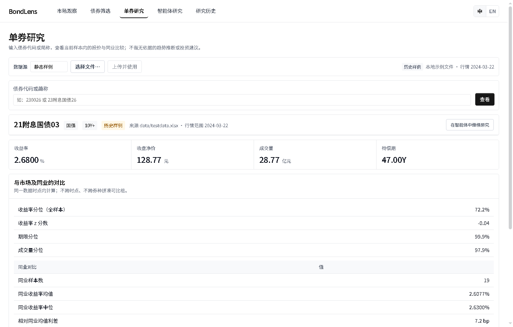
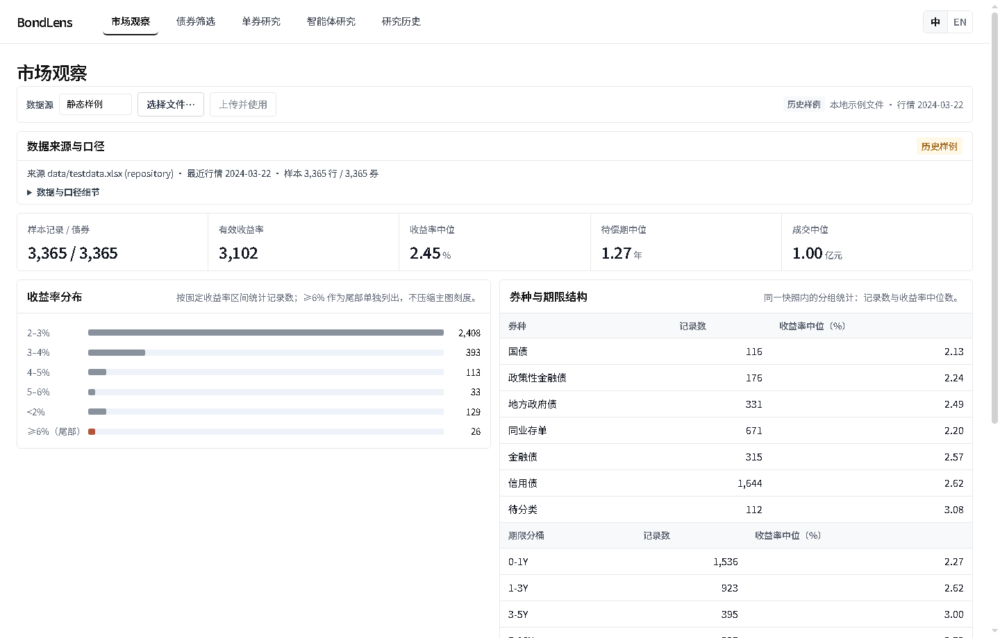
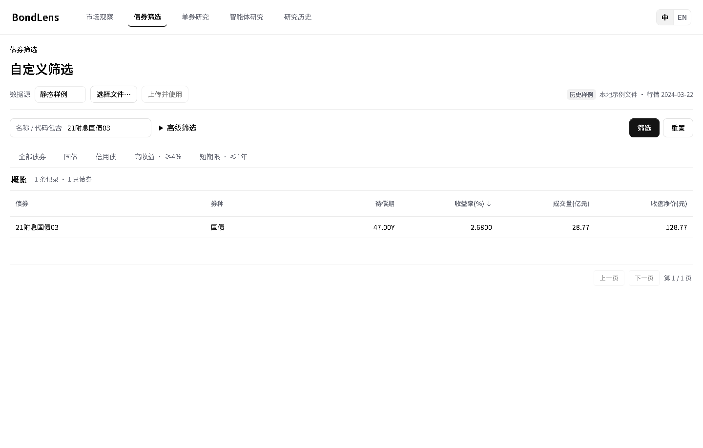
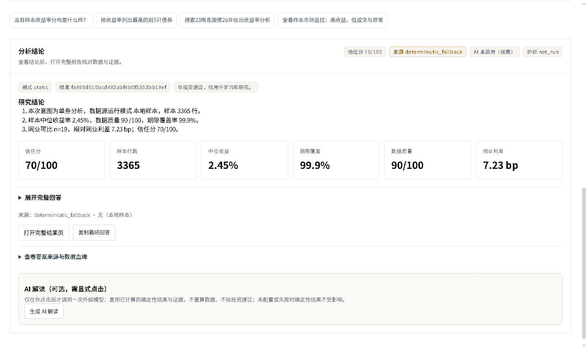
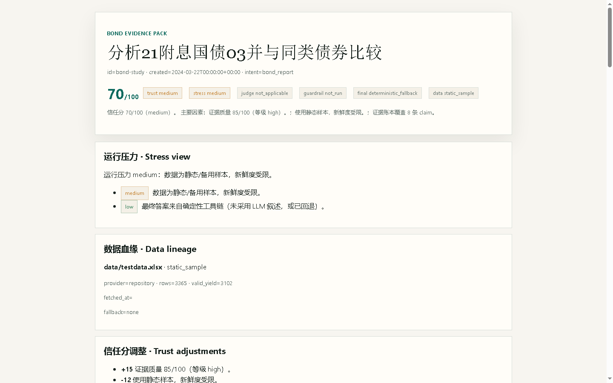
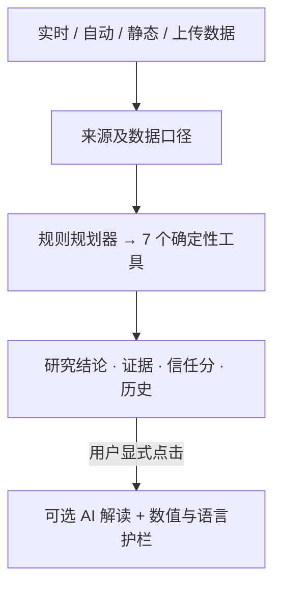

# BondLens

[English](README.md) · [简体中文](README.zh-CN.md) · [技术指南](docs/TECHNICAL_GUIDE.zh-CN.md)

从债券行情样本出发，完成**市场观察 → 债券筛选 → 单券同业比较 → 确定性研究 → 证据与历史回溯**的本地工作台。分析数字来自可检查的工具，AI 解释仅在用户明确点击后按需启用。

 

内置样本无需配置模型或 API Key。BondLens 用于研究与学习，不提供投资建议，也不是交易系统。

## 一条真实、可复现的研究案例

**研究对象：21附息国债03。** 数据来自仓库内 **2024-03-22 历史静态样本**（3,365 条行情记录，不是实时数据）。以下数字和截图都由这一次固定研究对象与同一数据集生成：

| 目标券收益率 | 同券种、同期限桶可比记录 | 同业平均收益率 | 相对同业平均 |
| :---: | :---: | :---: | :---: |
| **2.68%** | **19 条** | **2.6077%** | **+7.23 BP** |

[](docs/portfolio_case/screenshots/03-bond.png)

**直接查看证据：** [阅读中英文案例说明](docs/portfolio_case/CASE_STUDY.zh-CN.md) · [打开可阅读的 HTML 研究报告（无需安装）](https://phoenix0531-sudo.github.io/BondLens/portfolio_case/bond-study.html) · [完整证据 JSON](docs/portfolio_case/bond-study.json) · [工作台计算数据 JSON](docs/portfolio_case/case-data.json)

这里的 19 条可比记录按**券种相同、期限桶相同并排除目标券**筛选。样本没有逐行行情日期，**无法证明各记录在同一天成交**；收益率差异也不是违约概率或投资信号。完整的计算口径、教学级久期假设与限制详见案例说明。

## 从市场到证据：同一个案例的真实界面

所有画面均从最新本地程序截取；不连接实时行情，也没有付费模型调用。图片可点击查看原图。

| ① 市场观察：数据来源、样本结构 | ② 债券筛选：精确定位目标券 |
| :---: | :---: |
| [](docs/portfolio_case/screenshots/01-market.png) | [](docs/portfolio_case/screenshots/02-screen.png) |
| ③ 确定性研究：结论、指标与限制 | ④ Evidence Pack：信任分和数据血缘 |
| [](docs/portfolio_case/screenshots/04-agent.png) | [](docs/portfolio_case/screenshots/06-evidence-pack.png) |

最后一步是 [⑤ 研究历史](docs/portfolio_case/screenshots/05-history.png)：保存的结果只读可回看，重新运行会产生新记录。该截图的记录全部生成于隔离演示目录，不包含私人研究历史。

也可以查看 [60 秒界面导览视频](https://phoenix0531-sudo.github.io/BondLens/portfolio_case/walkthrough.mp4)（使用以上真实截图制作的无声导览，并非交互录屏）。

**复现整个案例：**

```bash
python scripts/generate_portfolio_case.py          # 生成静态案例与HTML/JSON证据包
python scripts/generate_portfolio_case.py --check  # 从实际计算重新校验文件，不改写
node scripts/capture_portfolio_case.mjs            # 可选：在独立Edge/Flask环境重截六张图
python scripts/build_portfolio_walkthrough.py     # 可选：用FFmpeg重建界面导览视频
```

## 为什么这样设计

- **先计算，再叙述。** 规则意图规划从七个确定性债券分析工具中选择操作；检索、排序、市场统计和同业比较无需模型即可核对，可选模型不替代这些计算。
- **先说明口径，再比较。** 页面展示数据模式、来源、日期和缺失字段，不悄悄补造数据。同券种、同期限桶、同行情日的比较更有参考价值；缺少日期时无法核验是否同日。
- **先保留证据，再请求解读。** 研究结果可包含信任分、证据账本及可携带的 HTML/JSON Evidence Pack，保存的历史支持只读回看。AI 不会自动调用；仅用户明确请求且配置了服务时才可能外联，发送导入数据前还需确认。



## 无需安装，先看报告

以下是此前保存的**其他静态 HTML 演示**（与上方统一单券案例是不同的历史运行），不是正在运行的交互服务：

- [市场概览](https://phoenix0531-sudo.github.io/BondLens/demo_runs/demo-market-overview.html)
- [旧版单券报告](https://phoenix0531-sudo.github.io/BondLens/demo_runs/demo-bond-report.html)
- [收益异常报告](https://phoenix0531-sudo.github.io/BondLens/demo_runs/demo-yield-outliers.html)

[GitHub Pages](https://phoenix0531-sudo.github.io/BondLens/) 是静态项目介绍页，不是在线工作台。

## 本地运行

部署基线为 Python 3.12，支持 Python 3.11+。以下命令显式使用离线静态样本，不需要 API Key。

**Windows PowerShell**

```powershell
py -3.12 -m venv .venv
.\.venv\Scripts\Activate.ps1
python -m pip install -r requirements.lock
$env:BOND_DATA_MODE = 'static'
python app.py
```

**Linux / macOS**

```bash
python3.12 -m venv .venv
source .venv/bin/activate
python -m pip install -r requirements.lock
export BOND_DATA_MODE=static
python app.py
```

打开 **http://127.0.0.1:5000/**。本地服务默认绑定回环地址，可通过 `PORT` 修改端口。Docker、环境变量、API 和测试命令见[技术指南](docs/TECHNICAL_GUIDE.zh-CN.md)；Compose 默认映射端口为 8765。

## 数据与安全边界

- **Live** 严格实时，失败即报错，不回退快照或静态样本。**Auto** 可依次回退至有效快照和静态样本，并显示实际来源与时间。**Static** 不访问实时供应商。**Import** 保存在内存中，过期后须重新上传。
- 样本不包含主体评级、财务报表或信用事件。久期和 DV01 基于明示的教学级假设，并非完整估值模型；收益异常仅供研究，不是交易建议。
- 历史保存经过隐私规约的派生结果，不保存上传原件；部分导入文本无法恢复，旧摘要记录也无法恢复完整结果。重新运行会生成新记录。脱敏是尽力处理，请勿输入密钥或敏感标识。
- 历史首页由服务端按 20 条分页；数千条记录的首次关键词全量搜索仍可能较慢：3,300 条隔离记录的测试约需 19.5 秒。存储和限制详见[技术指南](docs/TECHNICAL_GUIDE.zh-CN.md#历史与证据包)。
- 系统没有内置认证或按用户隔离的历史，请仅在可信本机使用，不适合作为公网多用户服务。真实 Live 供应商和付费模型未经过生产验证。

## 验证与背景

**2026-10-31** 的独立本地运行记录为 **252 passed、1 skipped**；提交 `595b87e` 的 GitHub Actions 已成功。这是历史结果，当前 CI 状态以 badge 为准。

BondLens 起源于 2024 年本科毕业设计，原始版本保留在 `undergraduate-thesis-2024` 分支。工具目录、API、导入映射、部署、证据包与已有演示资料见[技术指南](docs/TECHNICAL_GUIDE.zh-CN.md)。

采用 [MIT 许可证](LICENSE)。本项目不提供投资建议，也不声称覆盖完整市场。
