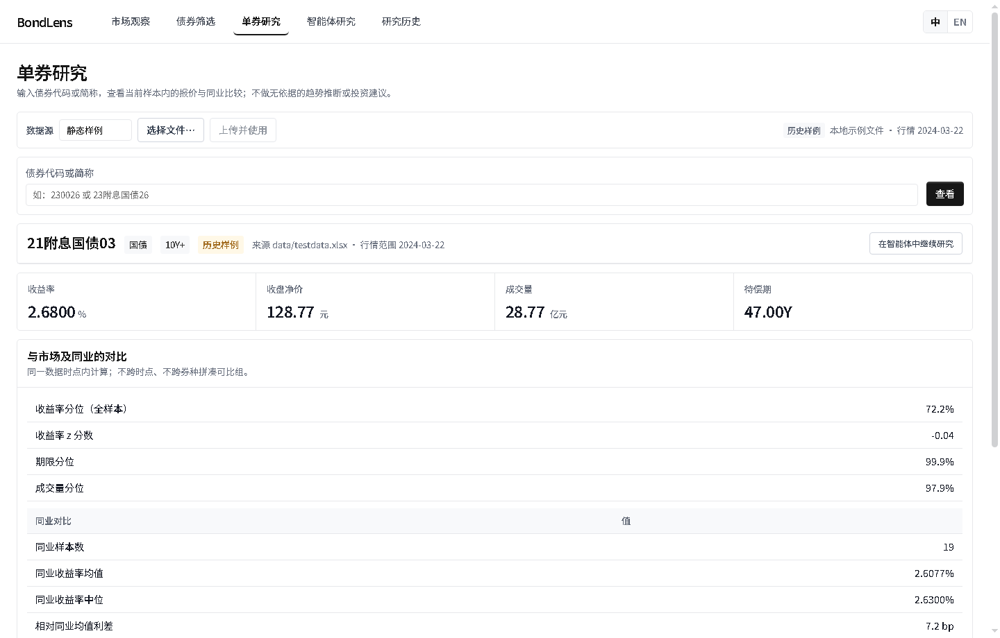
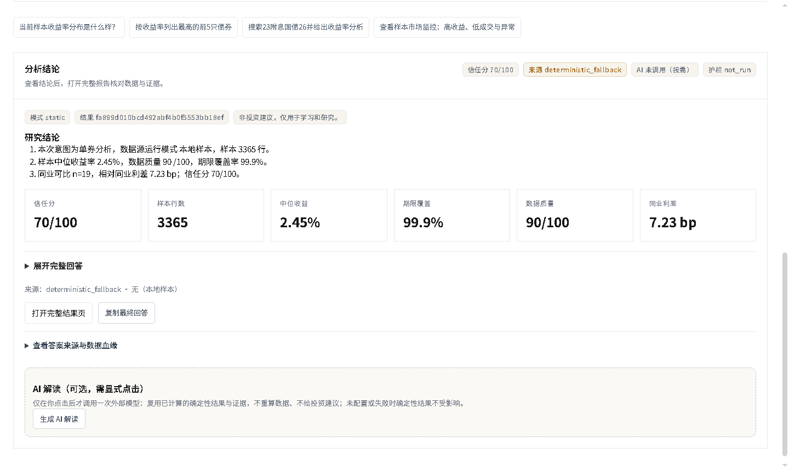

# Bond research case: 21附息国债03

[中文](CASE_STUDY.zh-CN.md) · [Static evidence pack](bond-study.html) · [Data and comparison JSON](case-data.json) · [Evidence JSON](bond-study.json)

## Question and source

> 分析21附息国债03并与同类债券比较

Repository static sample `data/testdata.xlsx`, sample date 2024-03-22: 3365 records, including 3102 valid yields. This is not a live quote. The name has 1 exact match; the sample has no security-code column, so the code is missing. Counts represent quote rows, not necessarily unique securities.

## Observation

The target is a Chinese government bond with 47.0 years remaining (10Y+ bucket). Its closing clean price is 128.77 yuan, closing yield 2.68%, weighted yield 2.6777%, and volume 28.77 hundred million yuan. Values come directly from `/api/bond/detail`; derived figures retain the API's rounded output precision.

`compare_bond_to_market` compares 19 other records of the same bond type and maturity bucket. Their mean yield is 2.6077% and median 2.63%; the target's peer yield percentile is 100.0, and its spread over the mean is 7.23 bp. This percentile is a tool-calculated relative position, not a default probability. The sample has no per-row quote date column: the sample date does not establish same-day alignment.

Under teaching assumptions, modified duration is 26.548 and DV01 is 0.26548. These use annual coupons, coupon defaulting to yield under a par assumption, and whole periods; they are not a full valuation or actual cash-flow schedule.

## Path and limitations

The fixed question follows the rule-based tool path: `search_bonds → compare_bond_to_market → describe_market → rank_bonds → detect_yield_outliers → build_market_monitor → generate_bond_report`. The workbench and agent call the same comparison tool; their peer outputs match in this case. The static pack uses a fixed generation timestamp of 2024-03-22T00:00:00+00:00 for reproducibility, not the actual execution or quote time. Its JSON and HTML are exported from the same object.

Issuer ratings, financial statements, guarantees and credit events are absent; yield spreads alone cannot establish credit risk. This case is for research and education, not investment advice. Reproduce from the repository root with `python scripts/generate_portfolio_case.py`; `--check` verifies without writing outputs.

## Screenshots for this same bond

| Single-bond comparison | Deterministic research result |
| :---: | :---: |
|  |  |
| [Screening](screenshots/02-screen.png) · [Market source](screenshots/01-market.png) | [Evidence pack view](screenshots/06-evidence-pack.png) · [Isolated history](screenshots/05-history.png) |

These images were captured from the real local application; ephemeral result IDs can differ between captures. The case JSON and HTML evidence pack are the source of truth for numeric results. The [60-second silent screenshot tour](walkthrough.mp4) is not a recording of live clicks.
