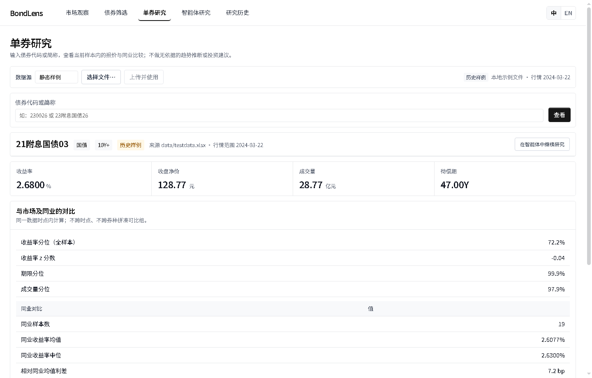
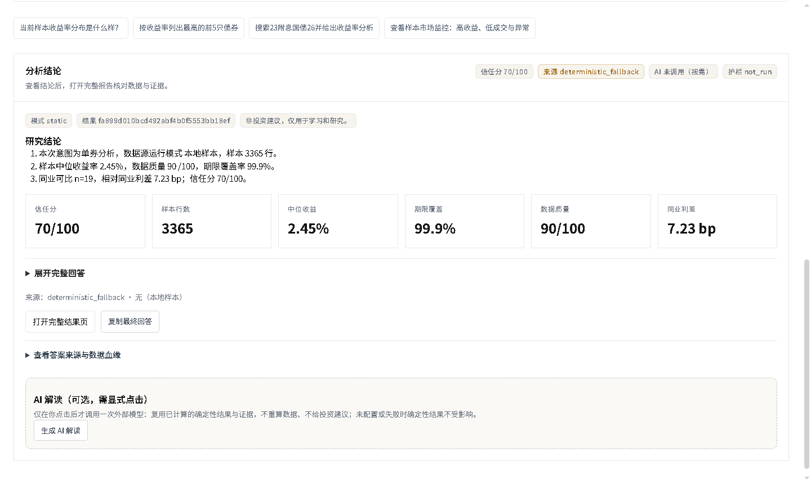

# 单券研究案例：21附息国债03

[英文](CASE_STUDY.md) · [静态证据包](bond-study.html) · [数据与比较 JSON](case-data.json) · [证据 JSON](bond-study.json)

## 问题与来源

> 分析21附息国债03并与同类债券比较

静态仓库样本 `data/testdata.xlsx`，样本日期 2024-03-22，共 3365 条记录、3102 条有效收益率；不是实时行情。名称精确匹配 1 条，样本没有证券代码列，代码缺失。记录按行情行计数，并非保证唯一债券数。

## 观察

目标为国债，待偿期 47.0 年（10Y+）；收盘净价 128.77 元，收盘到期收益率 2.68%，加权收益率 2.6777%，成交量 28.77 亿元。这些数值直接取自 `/api/bond/detail`；API 的派生数值已按其输出精度舍入。

`compare_bond_to_market` 以相同券种、相同期限桶且排除目标券的 19 条记录为同业：平均收益率 2.6077%，中位数 2.63%，目标收益率在同业中的百分位为 100.0，高于同业平均 7.23 bp。此百分位是工具计算的相对位置，不是违约概率。样本没有逐行行情日期列，无法验证是否同日；展示的样本日期不能替代逐行日期。

教学假设下修正久期 26.548，DV01 0.26548。计算采用年付息、票息默认等于到期收益率的平价假设和整数期数，并非完整估值或真实现金流。

## 路径与局限

固定问题经规则规划运行工具：`search_bonds → compare_bond_to_market → describe_market → rank_bonds → detect_yield_outliers → build_market_monitor → generate_bond_report`。工作台和代理调用相同的比较工具；本次两者同业输出一致。静态证据包使用固定生成时间 2024-03-22T00:00:00+00:00 以便复现，该时间不是实际运行时间或行情时间。证据包 JSON 与 HTML 来自同一导出对象。

不含主体评级、财报、担保或信用事件；收益率差异不能解释为信用风险结论。该案例仅供研究和学习，不是投资建议。重现：在仓库根目录运行 `python scripts/generate_portfolio_case.py`；`--check` 只校验不改写。

## 同一研究对象的界面证据

| 工作台单券比较 | 确定性分析结果 |
| :---: | :---: |
|  |  |
| [筛选入口](screenshots/02-screen.png) · [市场来源](screenshots/01-market.png) | [证据包画面](screenshots/06-evidence-pack.png) · [隔离历史画面](screenshots/05-history.png) |

这些图片从真实本地程序抓取，截图可能含不同的临时结果 ID；计算指标以本案例 JSON 与 HTML 证据包为准。可看 [60 秒无声截图导览](walkthrough.mp4)，它不是实际点击操作的录屏。
